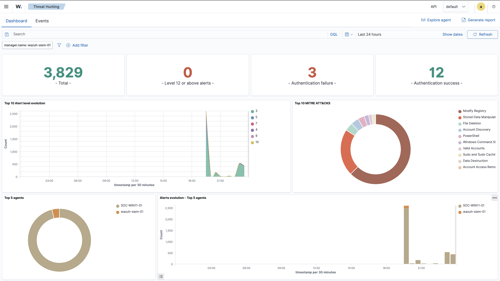
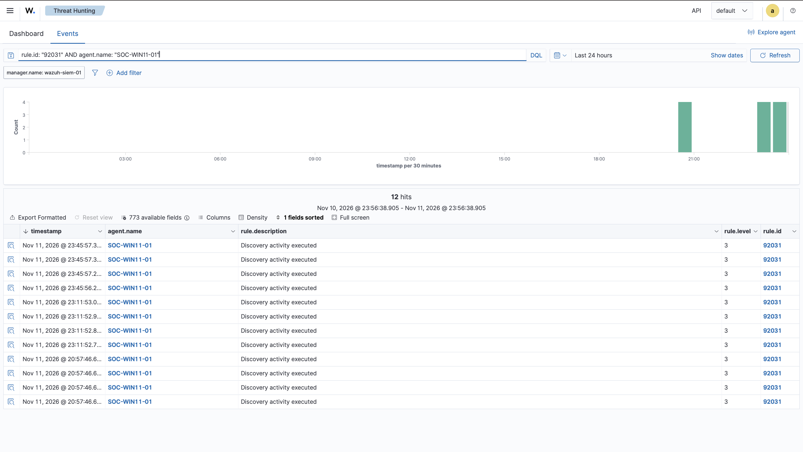
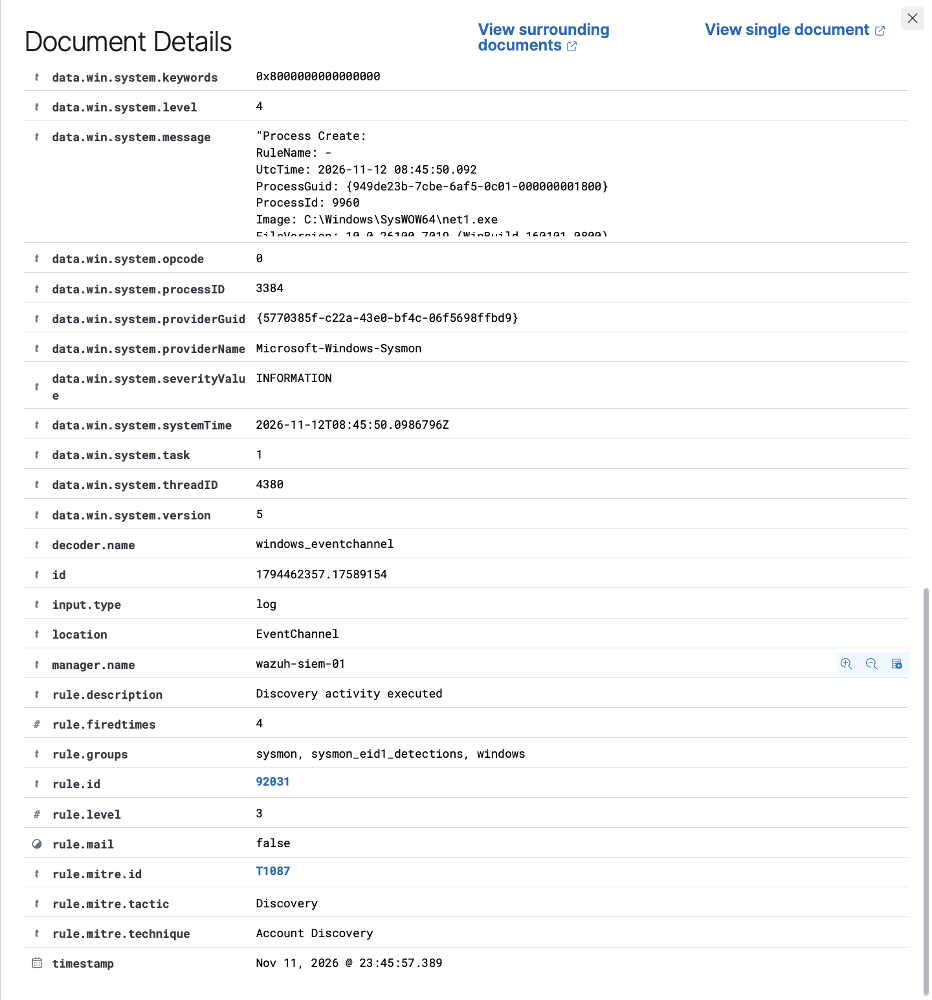

# SOC Investigation #001 — Windows Account Discovery

**Sysmon + Wazuh | Alert triage | MITRE ATT&CK T1087**

> **Disposition:** Likely benign monitoring activity (moderate confidence). The observed activity was **not** established as a malicious attack.

## Overview

This hands-on SOC investigation examines Windows account-discovery commands detected by Wazuh on a Windows 11 lab endpoint. Sysmon process-creation telemetry was forwarded by the Wazuh agent, producing **rule `92031` — “Discovery activity executed”**. The investigation focused on validating the alert, tracing process ancestry, and assessing whether the activity warranted escalation.

## Lab environment

| Component | Role |
|---|---|
| Windows 11 ARM (`SOC-WIN11-01`) | Monitored endpoint |
| Sysmon | Process creation telemetry (Event ID `1`) |
| Wazuh Windows agent | Collects and forwards Sysmon Operational events |
| Ubuntu Server (`wazuh-siem-01`) | Wazuh manager, indexer, and dashboard |
| VMware Fusion | Virtualized lab environment |

**Telemetry flow:** `Windows process → Sysmon Event ID 1 → Wazuh agent → Wazuh manager/rule 92031 → Threat Hunting dashboard`

## Detection and evidence

| Field | Observed value |
|---|---|
| Wazuh rule | `92031` |
| Description | `Discovery activity executed` |
| Severity | Level `3` |
| MITRE ATT&CK | `T1087` — Account Discovery (Discovery tactic) |
| Log provider | `Microsoft-Windows-Sysmon` |
| Event type | Process creation (Sysmon Event ID `1`) |
| Observed command | `net user` |
| Observed executable | `net.exe` / `net1.exe` |
| Execution context | `NT AUTHORITY\SYSTEM` |
| Matching alerts in dashboard query | `12` within the selected 24-hour window |

The investigated process ancestry was:

```text
wazuh-agent.exe
└── net.exe
    └── net1.exe
```

The Wazuh agent was observed as the initiating parent process. This is consistent with endpoint monitoring activity, but the specific Wazuh component that invoked the command was **not independently confirmed**.

## Investigation workflow

1. Verified Sysmon process-creation events on the Windows endpoint.
2. Configured the Wazuh agent to collect `Microsoft-Windows-Sysmon/Operational`.
3. Verified Wazuh ingestion and rule `92031` alerts.
4. Queried **Threat Hunting → Events** with:

   ```text
   rule.id: "92031" AND agent.name: "SOC-WIN11-01"
   ```

5. Reviewed matching alerts, Sysmon event fields, command lines, and parent-child relationships.
6. Classified the observed activity based on the available process context, while noting attribution limits.

## Screenshots

### 1. Threat Hunting dashboard



### 2. Rule 92031 alert results



### 3. Sysmon alert document details



## Assessment and lessons learned

**Assessment:** Likely benign monitoring activity; **confidence: moderate**. The Wazuh agent ancestry supports a monitoring-related explanation. However, this evidence does not identify the exact Wazuh module or prove that every similar account-discovery alert is benign.

**SOC skills demonstrated:** Endpoint log collection, SIEM alert filtering, Sysmon analysis, process-tree reconstruction, MITRE ATT&CK mapping, and evidence-based alert triage.

**Next steps:** Correlate future account-discovery detections with additional telemetry, verify the initiating component where possible, and avoid broad suppression of rule `92031`.

## Full investigation report

Read the detailed report: **[Account-Discovery-Investigation.md](reports/Account-Discovery-Investigation.md)**.

---

*This project was performed in a controlled personal cybersecurity lab. Screenshots reflect the state of the lab at the time of collection.*
